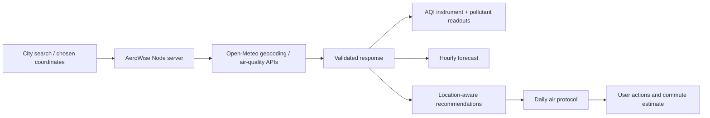

<div align="center">

# ✦ A E R O W I S E
### **3D AIR INTELLIGENCE OS**

<p><em>See the air. Understand the world. Make a better plan.</em></p>

<p>
  
</p>

<p>
  
  
  
  
</p>

<p>
  <strong>An immersive environmental dashboard that turns modeled air-quality forecasts into practical choices for your day.</strong>
</p>

<p>
  <a href="#-get-started">Get started</a> ·
  <a href="#-features">Explore features</a> ·
  <a href="#-api-map">API map</a> ·
  <a href="#-testing">Testing</a>
</p>

</div>

---

## ◉ The mission

Air-quality scores are useful—but a number alone does not tell someone how to plan a run, improve a room, or compare a commute. **AeroWise** connects a location's modeled air forecast with an interactive 3D Earth, an hourly trend, household-aware suggestions, and small actions users can explore.

> **One forecast. Clearer context. More useful everyday decisions.**

<div align="center">

| 🌐 Explore | 📡 Understand | 🌿 Act |
|:---:|:---:|:---:|
| Interactive 3D Earth | AQI and pollutant context | A plan shaped around your routine |
| City markers and visual layers | Hourly forecast and best relative window | Indoor-air habits and commute alternatives |

</div>

## ✦ Features

<details open>
<summary><strong>🌍 Interactive planetary interface</strong></summary>
<br />

- Three.js / WebGL Earth with drag rotation and zoom.
- City markers and multiple visualization modes: planet, air field, cities, forecast, and layers.
- A lightweight 2D planet fallback when the 3D module cannot load.
- Atmospheric glow, particles, and orbital visuals are **illustrative**, not measured pollution plumes.

</details>

<details>
<summary><strong>📊 Air-quality intelligence</strong></summary>
<br />

- Modeled air-quality data from Open-Meteo for the selected coordinates.
- U.S. AQI when available; otherwise, the interface labels European AQI.
- PM2.5, PM10, ozone, nitrogen dioxide, and additional returned pollutants.
- Hourly forecast, selected-hour details, and a lower-forecast-hour comparison.
- Explicit **LIVE DATA**, **STALE DATA**, **DEMO DATA**, or unavailable states—no silent fabricated live readings.

</details>

<details>
<summary><strong>🧭 A personal air protocol</strong></summary>
<br />

- City search and an optional, user-triggered browser location request.
- Recommendations that adapt to the selected location and routine preferences.
- A conceptual indoor-air room with ventilation and purifier controls.
- A commute comparison calculator that estimates direct-use CO₂e from editable assumptions.
- A locally saved plan and shareable update.

</details>

<details>
<summary><strong>💬 An assistant that still works without a key</strong></summary>
<br />

- Built-in guidance is available by default.
- Optional server-side AI-generated answers can be enabled with `OPENAI_API_KEY`.
- API keys never belong in browser code or a committed `.env` file.

</details>

## ⚡ Get started

**Requirements:** Node.js 20 or newer. The server and tests use Node's built-in modules; no `npm install` is required.

### Windows PowerShell

```powershell
# Move into the folder that contains server.mjs
cd "C:\path\to\aerowise-work"

# Start AeroWise
npm start
```

Then open **[http://127.0.0.1:4173](http://127.0.0.1:4173)** and keep the terminal open while using the app.

### If port 4173 is already in use

Use a different port in the same PowerShell window:

```powershell
$env:PORT = "4174"
npm start
```

Then open **[http://127.0.0.1:4174](http://127.0.0.1:4174)**. Stop the server with `Ctrl+C`.

### Optional AI answers

The assistant uses built-in guidance unless an API key is configured. To enable AI answers for the current PowerShell session:

```powershell
$env:OPENAI_API_KEY = "your-key"
$env:OPENAI_MODEL = "your-supported-model"
npm start
```

Remove the key from the current session when finished:

```powershell
Remove-Item Env:OPENAI_API_KEY
Remove-Item Env:OPENAI_MODEL
```

`.env.example` documents the optional variables, but the app intentionally does not load `.env` files automatically. **Never commit real API keys.**

## 🛰️ How the data flows



The server validates coordinates and request bodies, adds provider timeouts, and returns consistent JSON errors. If live data cannot be retrieved, the UI can use its clearly labeled in-app demo generator or show an unavailable state. Hourly forecast data arrives in the air-quality response; the project does not need a separate forecast endpoint.

## 🧪 Testing

Run the syntax checks and automated tests from the project root:

```powershell
npm run check
npm test
```

The Node test suite covers frontend initialization, live values including numeric zero, loading fallback, stale-data retention, server assets, and API validation/error behavior. The deterministic demo readings are generated in `public/app.js` and are always labeled as examples.

## 🗺️ API map

| Method | Route | Purpose |
|:--|:--|:--|
| `GET` | `/api/health` | Server status and optional AI configuration status |
| `GET` | `/api/geocoding?name=Delhi` | Search for a city and return coordinates |
| `GET` | `/api/air-quality?latitude=28.6&longitude=77.2` | Current modeled air values and hourly data |
| `POST` | `/api/advice` | Built-in guidance or optional AI answer |

## 🧱 Project structure

```text
.
├── assets/
│   └── aerowise-orbit.gif   # Animated README hero
├── public/
│   ├── index.html           # App structure
│   ├── styles.css           # Responsive visual system
│   ├── app.js               # Data flow and interactions
│   └── scene.js             # Interactive 3D Earth
├── tests/
│   ├── frontend.test.mjs
│   └── server.test.mjs
├── .env.example
├── .gitignore
├── package.json
├── server.mjs
├── PITCH.md
└── README.md
```

## 🔐 Trust, data, and limitations

- **Live data is modeled forecast output**, not necessarily a nearby regulatory monitoring-station reading.
- The planet's haze, particles, and visual overlays explain the experience; they are not precise spatial pollution measurements.
- Indoor-air controls are a conceptual habit visualizer, not indoor sensors.
- Trip savings are estimates based on explicit distance and emissions assumptions—not a measured change in local AQI.
- AQI scales are labeled. Pollutant concentrations and AQI indexes are different kinds of values and are not interchangeable.
- AeroWise is a planning aid, not an official alert service or medical tool. Follow local public-health guidance for health decisions.

## 🎬 45-second demo flow

1. Search for **London** or another city and inspect the live or demo source label.
2. Rotate the planet and switch between its visualization modes.
3. Explore the hourly forecast and select an hour.
4. Change a household or commute preference and refresh the daily protocol.
5. Toggle the conceptual room controls and compare a commute in the CO₂e calculator.
6. Ask the assistant a question. If live data is unavailable, switch to **Demo View** and keep the demo label visible.

## 🛠️ Built with

<p>
  
  
  
  
  
</p>

## ✧ Credits

- Air-quality and geocoding data: [Open-Meteo](https://open-meteo.com/).
- The animated planet artwork above is an original visual made for the AeroWise README. It is branding artwork—not a screenshot or a live pollution map.
- Commute emissions are illustrative estimates; the project pitch documents the limitations and recommends validating region-appropriate factors before public release.

---

<div align="center">

**AEROWISE** · *Make the invisible easier to understand.*

<sub>Built as an interactive environmental-planning project. Keep the data honest. Keep the interface human.</sub>

</div>
