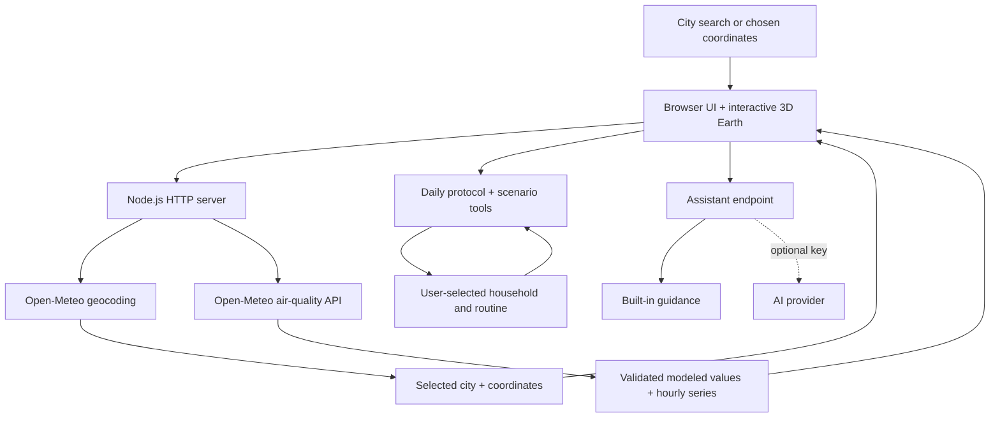

[Uploading AeroWise-Complete-3D-README.md…]()
<div align="center">


# A E R O W I S E
### 3D AIR INTELLIGENCE OS

**See the air. Understand the world. Make a better plan.**

<p>
  
  
  
  
</p>

<p>
  <a href="#-the-mission">Mission</a> ·
  <a href="#-experience-the-interface">Experience</a> ·
  <a href="#-run-it-locally">Run locally</a> ·
  <a href="#-system-architecture">Architecture</a> ·
  <a href="#-api-map">API</a> ·
  <a href="#-verification">Tests</a>
</p>

<sub>A cinematic environmental-planning project that turns modeled air-quality forecasts into useful everyday choices.</sub>

</div>

---

## ✦ The mission

Air-quality scores give people a signal—but a number alone does not explain how to plan an outdoor activity, improve everyday habits at home, or compare a commute. **AeroWise** combines a location's modeled air-quality forecast with an interactive 3D Earth, an hourly trend, routine-aware suggestions, a conceptual indoor-air scene, and an emissions scenario calculator.

> One forecast. More context. A clearer plan for the day.

<div align="center">

| ◉ OBSERVE | ◈ UNDERSTAND | ✧ ACT |
|:---:|:---:|:---:|
| Explore a 3D planet and choose a city | Read AQI, pollutant levels, and hourly trends | Build a daily protocol around your routine |
| **Interactive** | **Contextual** | **Actionable** |

</div>

## 🌌 Experience the interface


<sub>Visual concept only: the animation above is README artwork, not a screenshot of live data. In the running app, data values and their source state are shown separately.</sub>

### What you can do

<table>
  <tr>
    <td width="50%" valign="top">
      <h3>🌍 Interactive 3D Earth</h3>
      Rotate the globe, explore city markers, zoom, and switch between planet, air-field, city, forecast, and layer views. If the WebGL module cannot load, the interface has a lighter fallback.
    </td>
    <td width="50%" valign="top">
      <h3>📡 Air-quality console</h3>
      Inspect the available AQI scale, PM2.5, PM10, ozone, nitrogen dioxide, and other returned pollutant values. Missing readings stay missing; they are not silently invented.
    </td>
  </tr>
  <tr>
    <td width="50%" valign="top">
      <h3>🕒 Hourly forecast</h3>
      Explore the available hourly trend and compare a relative lower-index time window. The lower value is not a guarantee that conditions are safe for every person.
    </td>
    <td width="50%" valign="top">
      <h3>🧭 Daily air protocol</h3>
      Tune suggestions to your selected city, household, and routine. The interface explains when advice is general, demo-based, stale, or based on the current modeled response.
    </td>
  </tr>
  <tr>
    <td width="50%" valign="top">
      <h3>🏠 Indoor-air room</h3>
      Explore conceptual ventilation and purifier controls with practical habit guidance. This scene is not an indoor sensor and does not measure room air.
    </td>
    <td width="50%" valign="top">
      <h3>🌱 Impact studio</h3>
      Compare commuting scenarios and estimate direct-use CO₂e from distance, trip frequency, and editable transportation assumptions. This is not a measurement of local AQI change.
    </td>
  </tr>
</table>

### Built-in assistant

Ask practical questions about AQI, outdoor plans, indoor habits, or commuting. Built-in guidance works without an AI key. Optional generated answers can be enabled on the server; keys are never placed in browser JavaScript.

---

## ⚡ Run it locally

### Requirements

- **Node.js 20 or newer**
- A browser with WebGL support for the full 3D scene
- Internet access for live Open-Meteo data and externally loaded 3D assets/fonts
- No `npm install` is required; the app uses Node's built-in modules

### Windows PowerShell

Open a terminal in the folder that contains `server.mjs` and `package.json`:

```powershell
# Start the app
npm start
```

Open **[http://localhost:4173](http://localhost:4173)** and keep the terminal running while you use the site. Stop the server with `Ctrl+C`.

If port `4173` is already occupied, choose another port in that PowerShell session:

```powershell
$env:PORT = "4174"
npm start
```

Then open **[http://localhost:4174](http://localhost:4174)**. AeroWise reports a port conflict rather than automatically killing an unrelated process.

### Optional AI-generated answers

The assistant provides built-in guidance by default. To enable the optional server-side AI integration for the current PowerShell session:

```powershell
$env:OPENAI_API_KEY = "your-key"
$env:OPENAI_MODEL = "your-supported-model"
npm start
```

Remove the variables when finished:

```powershell
Remove-Item Env:OPENAI_API_KEY
Remove-Item Env:OPENAI_MODEL
```

`.env.example` is documentation only; this app does not automatically load `.env` files. **Never commit your real API key, token, or populated `.env` file.**

---

## 🧬 System architecture

<div align="center">
  
</div>

The interactive UI is served by the Node.js app. Browser requests use same-origin API paths; the server validates inputs, calls Open-Meteo, and returns JSON. The client then updates the instrument, hourly trend, and recommendations for the selected location.



<details>
<summary><strong>Why the data state matters</strong></summary>

AeroWise distinguishes **live modeled data**, **stale data**, **demo data**, and **unavailable data**. If a refresh fails, a previous valid response may remain visible as stale; when no valid response is available, the UI can fall back to clearly labeled example data or an unavailable state. Demo numbers must never be presented as current measurements.

</details>

---

## 🛰️ API map

| Method | Route | Purpose |
|:---|:---|:---|
| `GET` | `/api/health` | Server status and whether optional AI configuration is present; never returns the key |
| `GET` | `/api/air-quality?latitude=28.6&longitude=77.2` | Current modeled air values and hourly forecast |
| `GET` | `/api/geocoding?name=Delhi` | City search and coordinates |
| `POST` | `/api/advice` | Built-in guidance or an optional AI-generated response |

Example health check:

```powershell
Invoke-RestMethod http://localhost:4173/api/health
```

Example air-quality request:

```powershell
Invoke-RestMethod "http://localhost:4173/api/air-quality?latitude=28.6139&longitude=77.2090"
```

---

## 🧪 Verification

Run the available project checks from the repository root:

```powershell
npm run check
npm test
```

The automated test suite covers frontend initialization and data-state handling, numeric zero values, stale-data retention, the server's static assets, and API validation/error behavior. Run the tests locally before pushing changes.

---

## 🧱 Project structure

```text
.
├── assets/
│   ├── aerowise-orbit.gif       # Animated README hero
│   ├── aerowise-data-orbit.gif  # Animated instrument concept
│   └── aerowise-architecture.svg  # Isometric-style system diagram
├── public/
│   ├── index.html               # Page structure and accessible controls
│   ├── styles.css               # Responsive visual system
│   ├── app.js                   # Data loading, state, charts, and interactions
│   └── scene.js                 # WebGL Earth and 3D controls
├── tests/
│   ├── frontend.test.mjs
│   └── server.test.mjs
├── .env.example                 # Safe configuration template
├── .gitignore
├── package.json
├── server.mjs                   # API proxy and static server
├── PITCH.md                     # Hackathon pitch and demo flow
└── README.md
```

---

## 🔐 Data honesty & limitations

- Open-Meteo provides **modeled forecast output**. It is not necessarily a reading from a nearby regulatory monitoring station.
- The Earth haze, orbital particles, markers, and atmospheric effects are visual explanations; they do not represent measured spatial pollution plumes.
- The displayed AQI scale is labeled. U.S. AQI and European AQI are different scales; pollutant concentrations in `µg/m³` are not AQI values.
- The indoor-air room is a conceptual habit visualizer, not an indoor sensor.
- The commute calculator estimates direct-use CO₂e from editable assumptions. It does not claim to predict or measure a change in neighborhood AQI.
- AeroWise is a planning aid, not an official alert service or medical tool. Follow local public-health guidance for health decisions.

---

## 🎬 45-second demo run

1. Search for **London**, **New Delhi**, or another supported city. Check the current data-source label.
2. Rotate the planet and explore the available visualization modes.
3. Open the hourly forecast and select a point to inspect its time and value.
4. Change a household or routine preference and update the daily protocol.
5. Open the conceptual room controls and try different ventilation settings.
6. Compare a solo-car trip with a travel alternative in the impact studio.
7. Ask the built-in assistant a question. If live data is unavailable, use **Demo View** and keep its label visible.

---

## 🛠️ Tech stack

<p>
  
  
  
  
  
</p>

## ✦ Credits

- Air-quality and city-search data: [Open-Meteo](https://open-meteo.com/).
- Orbital hero and instrument GIFs are original README artwork. They are not screenshots of real-time data.
- The 3D Earth in the running app is interactive; GitHub Markdown itself cannot execute the live WebGL scene, so the README uses looping GIF artwork for visual motion.

---

<div align="center">


### **AEROWISE**
*Make the invisible easier to understand.*

<sub>Built for a more informed day. Keep the data honest. Keep the interface human.</sub>

</div>
