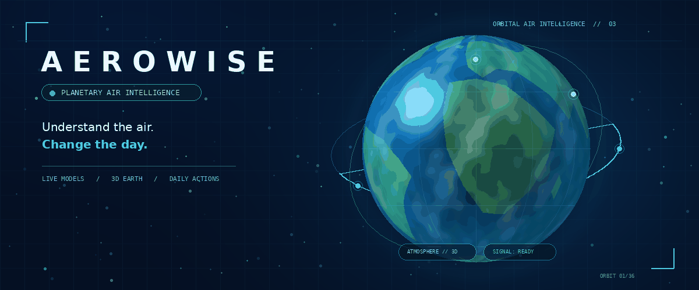
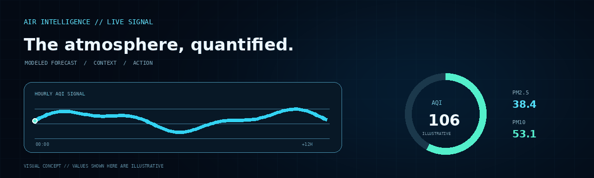
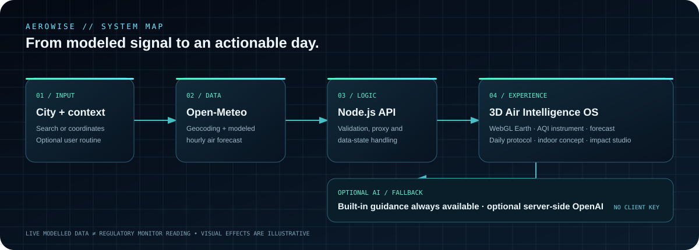
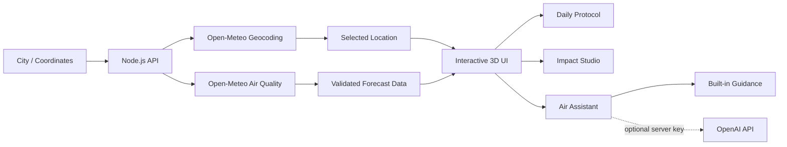

[AeroWise-Ultra-3D-README.md](https://github.com/user-attachments/files/35422445/AeroWise-Ultra-3D-README.md)
<div align="center">



# A E R O W I S E
### 3D AIR INTELLIGENCE OS

**SEE THE AIR. UNDERSTAND THE WORLD. MAKE A BETTER PLAN.**

<p>
  
  
  
  
</p>

[**Launch Live Demo ↗**](https://aerowise-air-quality-assistant.vercel.app/) &nbsp; · &nbsp; [Source Code](https://github.com/adarshmuchatte-lang/aerowise-air-quality-assistant) &nbsp; · &nbsp; [Hackathon Pitch](PITCH.md)

<sub>A cinematic environmental-planning experience that turns modeled air-quality forecasts into clearer everyday decisions.</sub>

</div>

---

<p align="center">
  
  
  
</p>

## ◉ The mission

Air-quality dashboards often stop at a number. **AeroWise goes one step further:** it connects a selected location and its available modeled forecast to an immersive 3D interface, a readable hourly trend, and practical planning tools.

The question is not only *“What is the AQI?”* — it is *“How can I use this information to plan my day more thoughtfully?”*

<table>
<tr>
<td width="33%" valign="top">
<h3>🌍 Explore</h3>
Move around an interactive WebGL Earth, inspect city markers, and switch environmental visualization modes.
</td>
<td width="33%" valign="top">
<h3>📡 Understand</h3>
Read AQI scales, pollutant concentrations, available forecast trends, and the state of the underlying data.
</td>
<td width="33%" valign="top">
<h3>✧ Act</h3>
Use a daily protocol, a conceptual indoor-air experience, and a commute-emissions scenario calculator.
</td>
</tr>
</table>

## ✦ The experience in motion



<sub>The animated panels are original README artwork. They demonstrate the visual language of AeroWise and are not screenshots of live measurements. The running app shows its actual data state separately.</sub>

## ✧ What's inside

<table>
<tr>
<td width="50%" valign="top">
<h3>01 / Interactive 3D Earth</h3>

- WebGL-powered planetary scene
- Globe rotation, camera controls and city markers
- Atmospheric glow, orbital effects and layered visuals
- Fallback behavior when the 3D scene cannot run
</td>
<td width="50%" valign="top">
<h3>02 / Air-quality console</h3>

- U.S. AQI and European AQI shown as distinct indices
- PM2.5, PM10, NO₂ and ozone where returned by the provider
- Available hourly modeled forecast
- Source, timestamp, loading and error states
</td>
</tr>
<tr>
<td width="50%" valign="top">
<h3>03 / Daily air protocol</h3>

Personalized suggestions shaped by the selected location, modeled forecast and user-selected routine. Recommendations explain context instead of presenting an AQI number without interpretation.
</td>
<td width="50%" valign="top">
<h3>04 / Indoor-air concept</h3>

An interactive room experience for exploring ventilation and purifier choices. It is an educational visualizer, not a real indoor air sensor.
</td>
</tr>
<tr>
<td width="50%" valign="top">
<h3>05 / Impact studio</h3>

Compare commute scenarios using distance, trip frequency and editable transportation assumptions to estimate potential direct-use CO₂e savings.
</td>
<td width="50%" valign="top">
<h3>06 / Air assistant</h3>

Built-in guidance for AQI, outdoor routines, indoor habits and commuting. Optional server-side OpenAI integration can provide generated answers when configured.
</td>
</tr>
</table>

## ⌘ System architecture





## ⚡ Run AeroWise locally

### Requirements

- **Node.js 20 or newer**
- A modern browser; WebGL is needed for the full 3D Earth
- Internet access for live Open-Meteo data and any remotely loaded visual assets
- No dependency installation is required for the current dependency-free Node server

### Windows PowerShell

Run these commands from the repository root — the folder containing `server.mjs`:

```powershell
npm start
```

Open **[http://localhost:4173](http://localhost:4173)** and keep the terminal open while using the app. Stop the server with `Ctrl+C`.

If port `4173` is already in use:

```powershell
$env:PORT = "4174"
npm start
```

Then open **[http://localhost:4174](http://localhost:4174)**. AeroWise does not automatically kill processes that occupy a port.

### Optional AI-generated responses

The built-in assistant works without an AI key. To enable the optional server-side OpenAI integration for the current PowerShell session:

```powershell
$env:OPENAI_API_KEY = "your-key"
$env:OPENAI_MODEL = "gpt-4.1-mini"
npm start
```

The current app does **not** automatically load `.env` files; set environment variables in the shell or configure them in your hosting provider. Never put a real API key in browser JavaScript or commit it to GitHub.

## 🛰️ API map

| Method | Route | Purpose |
|:--|:--|:--|
| `GET` | `/api/health` | Server health and optional AI configuration status (not the secret key) |
| `GET` | `/api/geocode?name=Delhi` | Search cities and return coordinates |
| `GET` | `/api/air-quality?latitude=28.6139&longitude=77.2090` | Current modeled air values and hourly series |
| `GET` | `/api/forecast?latitude=28.6139&longitude=77.2090` | Forecast endpoint where supported by the deployed version |
| `GET` | `/api/demo` | Clearly labelled deterministic example data |

Check server health locally:

```powershell
Invoke-RestMethod http://localhost:4173/api/health
```

Fetch air-quality data for New Delhi:

```powershell
Invoke-RestMethod "http://localhost:4173/api/air-quality?latitude=28.6139&longitude=77.2090"
```

## 🧪 Test it

```powershell
node --check server.mjs
node --check app.js
node --check globe.js
npm test
```

The repository includes Node test-runner tests for the air-model and server behavior. Run them locally before submitting changes.

## 🧭 Data honesty is part of the design

- **Live modeled data** means provider-supplied model output; it is not necessarily a regulatory-monitor measurement at the user's exact location.
- **Demo data** is illustrative and must remain clearly labelled.
- **AQI and concentration are different kinds of measurements.** U.S. AQI and European AQI are different scales; pollutant concentrations are displayed in units such as `µg/m³`.
- **3D haze, orbitals and atmospheric particles are visual effects**, not measured spatial pollution plumes.
- **Indoor-air controls are conceptual**, not sensor measurements.
- **CO₂e savings are estimates** based on user-provided trip scenarios and assumptions; they do not prove a local AQI improvement.
- AeroWise is a planning assistant, not an official emergency-alert service or a medical device. Follow local public-health guidance for health decisions.

## 🎬 45-second demo flow

1. Open the live demo and select a city.
2. Rotate the 3D Earth and explore the available modes.
3. Show the AQI and pollutant cards, then inspect the hourly forecast.
4. Update a preference and refresh the daily protocol.
5. Demonstrate the indoor-air controls and compare commute options.
6. Ask the assistant a question and show the data-source status.

## 🧱 Repository layout

```text
.
├── index.html           # App structure
├── styles.css           # Responsive visual system
├── app.js               # Data fetching, UI state and interactions
├── globe.js             # WebGL Earth and 3D controls
├── air-model.js         # Reading and AQI helpers
├── server.mjs           # Local Node server and API proxy
├── demo-air.json        # Clearly labelled demo fixture
├── package.json         # Start and test commands
├── air-model.test.mjs   # Air-model tests
├── server.test.mjs      # API/server tests
├── aerowise-planet-core.gif
├── aerowise-signal-console.gif
├── aerowise-system-map.svg
└── PITCH.md             # Hackathon pitch notes
```

## ✦ Built with

<p>
  
  
  
  
  
</p>

<div align="center">


### **AEROWISE**
*Make the invisible easier to understand.*

[Launch the live experience ↗](https://aerowise-air-quality-assistant.vercel.app/) · [Explore the source ↗](https://github.com/adarshmuchatte-lang/aerowise-air-quality-assistant)

<sub>Built for a more informed day. Keep the data honest. Keep the interface alive.</sub>

</div>
